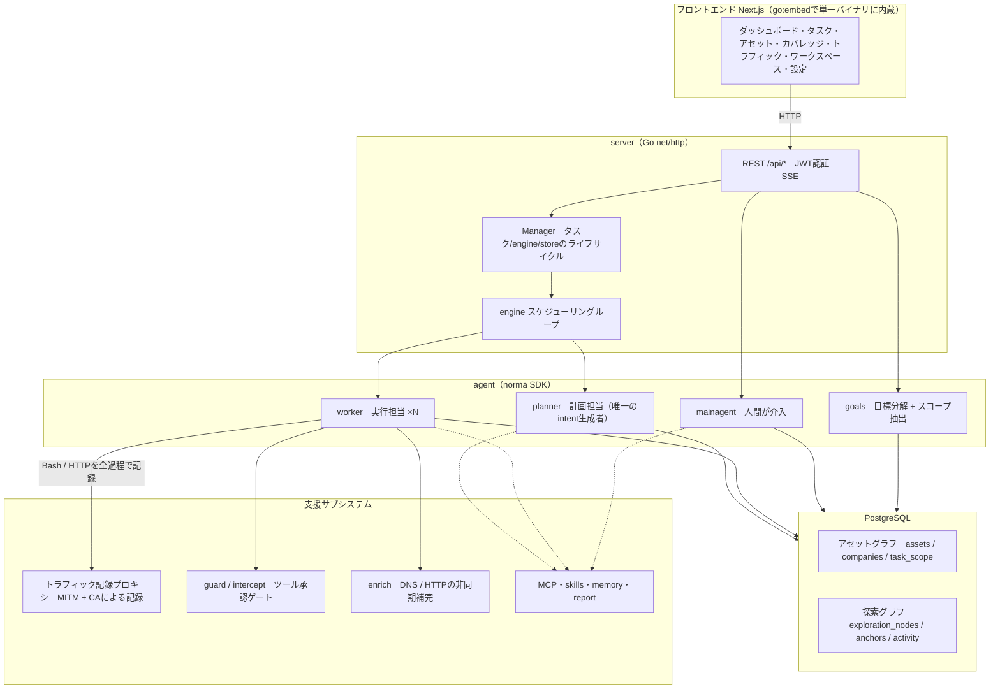
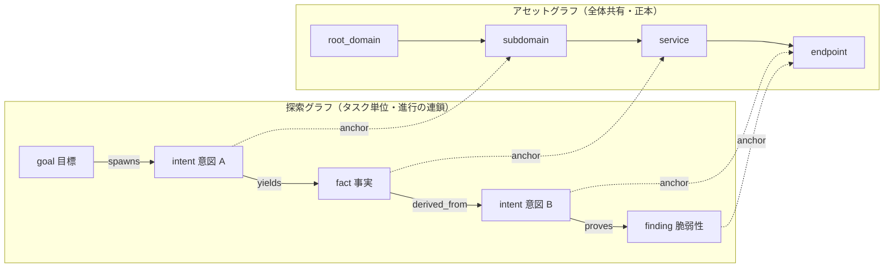
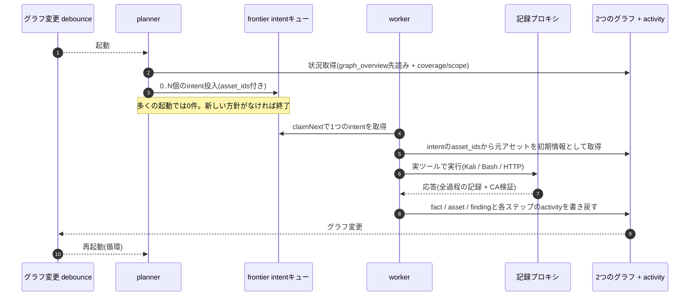
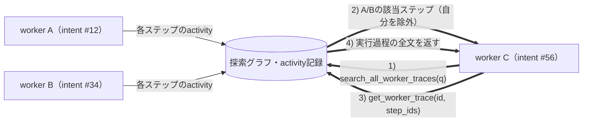
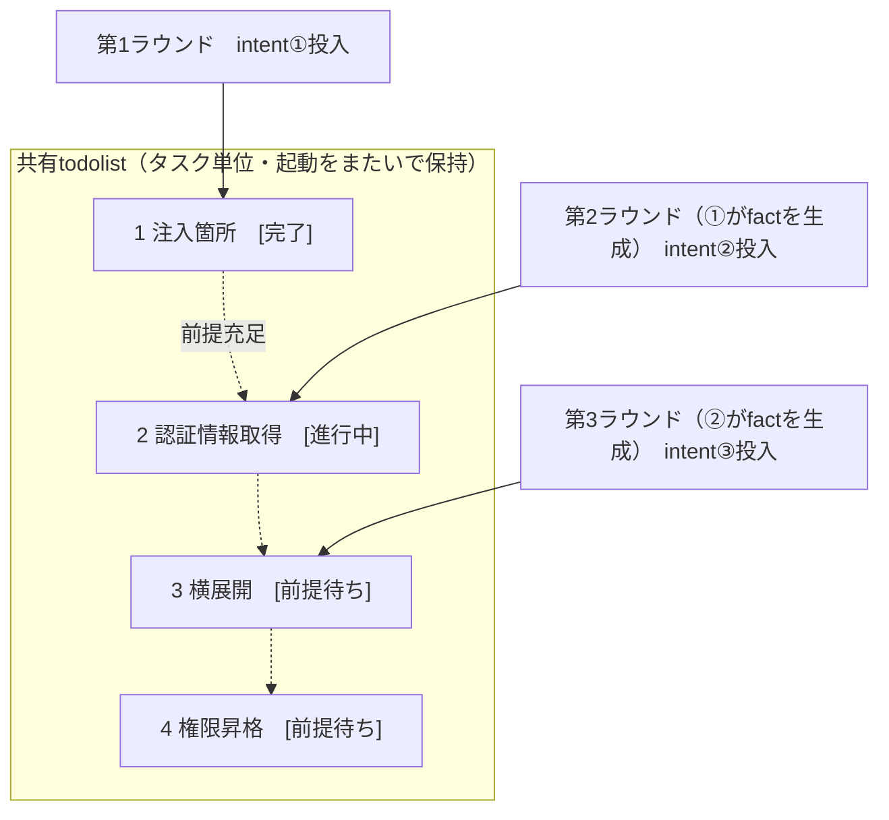

<div align="center">

# ARTEX

AIによる自律型ペネトレーションテストシステム（Goバックエンド + Next.jsフロントエンド）

🌐 **オンラインデモ**： [https://artex-demo.vercel.app/](https://artex-demo.vercel.app/)

</div>

---

## スクリーンショット

> 操作感は[オンラインデモ](https://artex-demo.vercel.app/)で確認できます。

| ダッシュボード（概要 / トークン使用量 / アクティビティ） | タスク一覧 |
| :---: | :---: |
|  |  |

| タスクの実行過程（セッション / ツール呼び出し） | 探索の流れ |
| :---: | :---: |
|  |  |

| 検出事項 | アセット |
| :---: | :---: |
|  |  |

| アセットカバレッジ図（力指向レイアウト・テスト済みの強調・ノードの折りたたみ） |
| :---: |
|  |

| トラフィック記録 | 人間が介入できる対話 |
| :---: | :---: |
|  |  |

| Agent管理 | LLM設定 |
| :---: | :---: |
|  |  |

| インターセプト承認 | バックエンドログ |
| :---: | :---: |
|  |  |

---

## 承認記録の詳細

全体の「承認記録」、タスク内の「インターセプト承認」、対話中の承認カードでは、詳細を展開して確認できます。表示構成は[AegisHookの承認詳細コンポーネント](https://github.com/RuoJi6/AegisHook/blob/main/web/src/components/CallDetail.vue)を参考にし、ARTEXのコンポーネントとテーマを使用しています。

## アセット同期（ScopeSentry）

[ScopeSentry](https://github.com/Autumn-27/ScopeSentry)からアセット情報を直接同期でき、重複収集を省けます。

- 「**アセット同期**」ページにScopeSentryのアドレスとAPI Keyを入力し、データソースに接続します。
- **プロジェクト**または**タスク**単位で、同期する対象とアセット種別（ドメイン / サブドメイン / IP / ポート / サイト / エンドポイントなど）を選択します。
- ワンクリックでインポートし、企業のアセット範囲に従って統合します。ARTEXのアセットグラフに入り、Agentの探索に利用できます。

---

## インストール

> データベースに**PostgreSQL**が必要です。探索には**LLM**の設定（`ANTHROPIC_API_KEY`または`OPENAI_API_KEY`。UIからも設定可能）が必要です。

### 方法1：インストールスクリプト（推奨）

```bash
git clone https://github.com/Hinln/ARTEX.git
cd ARTEX
./install.sh
```

スクリプトはDockerを検出・自動インストールした後、**① すべてDocker**または**② ローカルでビルドして実行**を選択させます。

- **① すべてDocker**：Postgresパスワードを入力（Enterでランダム生成）→ `.env`を自動生成 → `docker compose up -d`。
- **② ローカル実行**：DBを選択（既存DBに接続 / Dockerで起動）→ `config.json`を生成 → `go`でフロントエンド内蔵の単一バイナリをビルド → 起動。

完了後、**http://localhost:8787**を開きます（初回は`/setup`で管理者パスワードを設定）。

### 方法2：Docker Compose（手動）

```bash
git clone https://github.com/Hinln/ARTEX.git
cd ARTEX
cp .env.example .env          # POSTGRES_PASSWORDと、必要に応じてANTHROPIC_API_KEYを設定
docker compose up -d          # autumn27/artexイメージとpostgresを取得
# → http://localhost:8787
```

イメージには一般的なツール（ripgrep/curl/vim/npm/nmapなど）が含まれ、`./skills`と`./data`はバインドマウントで永続化されます。

リモートMCPはシステム設定で`http`（Streamable HTTP）または`sse`（旧SSE）を選択できます。
旧SSEサーバーは通常、`GET /sse`でイベントストリームを確立し、サーバーが返す`/message?sessionId=...`でJSON-RPCリクエストを受け取ります。設定時のURLは`/sse`、リクエストヘッダーは`Authorization=Bearer <token>`の形式で指定してください。

### 方法3：ビルド済みバイナリ（Releases）

[Releases](https://github.com/Hinln/ARTEX/releases)から対応プラットフォームのzipをダウンロードし、展開します。`artex`、`start.sh`（Windowsは`start.bat`）、`skills/`、`config.example.json`が含まれます。

```bash
cp config.example.json config.json   # databaseの接続情報を設定
./start.sh                           # → http://localhost:8787
```

> 起動には`start.sh` / `start.bat`を使用してください。終了コードに応じてプログラムを再起動する監視スクリプトで、**画面の[ワンクリック更新](#方法1画面からのワンクリック更新推奨)も、このスクリプトで入れ替えを完了します**。`./artex`を直接実行すると、更新後に再起動されません。
> バックグラウンド常駐：`nohup ./start.sh >artex.log 2>&1 &`。

### 方法4：ソースから単一バイナリをビルド

```bash
# 1) フロントエンドを静的エクスポート
cd web && npm ci && npm run build:static && cd ..
# 2) 埋め込み用ディレクトリへコピー
cp -r web/out server/webui/dist
# 3) ビルド（フロントエンドの埋め込みには-tags embeduiが必要）
CGO_ENABLED=0 go build -tags embedui -o artex ./cmd/artex
./start.sh
```

### 方法5：クロスプラットフォームのReleaseアーカイブを作成

`build.sh`はフロントエンドをビルド・埋め込み後、Goリンカーでデバッグ情報を除去し、配布ファイルをzipに圧縮します。Releaseモードでは、標準でLinux amd64/arm64、macOS amd64/arm64、Windows amd64のzipを生成します。

```bash
./build.sh --release
# 成果物：dist/artex-0.3.3-*.zip
```

UPXの自己展開バイナリは一部のLinuxカーネル、仮想環境、セキュリティポリシーと互換性がないため、標準では無効です。`ARTEX_TARGETS`で対象を指定できます。実行環境の互換性を確認できた場合は、`--upx`を明示してさらに縮小できます。

```bash
ARTEX_TARGETS=linux/amd64,windows/amd64 ./build.sh --release
./build.sh --target linux/amd64 --upx
```

---

## アップデート

> 更新ではプログラムのみを入れ替えます。Postgresボリューム`pgdata`、`./data`（jwt.key / SQLiteなど）、`./skills`は保持されます。**DBマイグレーションの手動実行は不要です**。`artex`は起動時に`schema.sql`（`ADD COLUMN` / `CREATE INDEX IF NOT EXISTS`を含む）を冪等に再実行します。更新前には`./data`とDBのバックアップを推奨します。

### このリポジトリの非公開Release更新元

画面のワンクリック更新は[Hinln/ARTEX Releases](https://github.com/Hinln/ARTEX/releases)からバージョンを確認・ダウンロードします。クローンやGitによるソース更新にも`Hinln/ARTEX`を使用します。元プロジェクトのGo moduleパスは維持されています。

更新元は非公開リポジトリです。ARTEXのバックエンドプロセスに`ARTEX_UPDATE_GITHUB_TOKEN`を設定してください。トークンには更新元リポジトリの**Contents: read**権限のみが必要です。バックエンドでReleaseの照会と添付ファイルのダウンロードに使われ、ブラウザーには送信されません。Gitにコミットしないでください。

```bash
# 現在のシェルまたはサービス環境にARTEX_UPDATE_GITHUB_TOKENを安全に設定してから起動
./start.sh
```

ローカルで直接起動する場合、`start.sh`は`.env`を自動読み込みしないため、プロセス環境へ変数をexportする必要があります。Docker ComposeではGit管理外の`.env`に設定し、artexコンテナーを再作成できます。イメージにこのブランチの更新コードが含まれている必要があり、旧イメージでは変数の設定だけで更新元は切り替わりません。

画面からインストールできる更新を提供するには、更新元リポジトリでdraftでもprereleaseでもない正式Releaseを公開し、`artex-<バージョン>-<os>-<arch>.zip`と`SHA256SUMS`を添付する必要があります。ソースだけではオンライン更新はできません。既存のReleaseワークフローは`v*`タグのpush時に、そのリポジトリ向けの添付ファイルを生成します。

### 方法1：画面からのワンクリック更新（推奨）

**システム設定**ページ（サイドバーの「システム設定」→ `/system/settings`）の**バージョンと更新**カードから、新バージョンを確認・インストールできます。

「更新」を押すと、実行環境の配布パッケージを取得 → Releaseの`SHA256SUMS`と照合 → 新バイナリを`-h`でスモークテスト → `artex.new`として一時保存 → プログラム終了 → `start.sh` / `start.bat`による再起動・入れ替え、の順で進みます。画面は新バージョンの起動を待って自動更新されます。

- **検証失敗時は現行版を継続**：検証やスモークテストに失敗した一時ファイルは破棄します。入れ替え後に3回連続で起動に失敗すると`artex.old`に自動復帰します（失敗版は調査用に`artex.failed`として保存）。
- **前バージョンへ戻せる**：前のバイナリを`artex.old`として保持し、カードに「前バージョンへロールバック」を表示します。DB構造は戻りません。
- **実行中のタスクは中断**：更新は再起動を伴うため、実行していない時間に行ってください。
- **開発ビルドは更新対象外**：バージョンが`dev`または接尾辞付きの`git describe`の場合、ローカルの開発用バイナリを正式版で上書きしないよう更新を無効にします。
- **Dockerではプログラムのみ更新**：playwright / nmapなどのツールは更新されません。`docker compose up -d`でコンテナーを再作成するとイメージ内の版に戻ります。イメージも更新する場合は`docker compose pull artex && docker compose up -d artex`を使用してください。
- GitHub接続にプロキシが必要な場合は、同じページの**グローバルプロキシ**を設定します。更新ファイルはGitHubドメインからHTTPSでのみ取得します。

### 方法2：更新スクリプト

```bash
cd ARTEX
./update.sh
```

スクリプトでは任意で`git pull`を実行した後、`install.sh`と同様に**① Docker更新**または**② ローカルビルド更新**を選択します。

- **① Docker**：イメージタグを指定（Enterで`.env`の`ARTEX_TAG`、未設定なら`latest`）→ `docker compose pull` → `docker compose up -d`（新イメージで再起動し、自動マイグレーション）。
- **② ローカル**：フロントエンドの静的成果物を再生成 → `./artex`を再ビルド（完了後、プロセスを再起動して反映）。

### 方法3：Docker Compose（手動）

```bash
cd ARTEX
git pull                       # compose / スクリプトを更新（任意）
# バージョン指定：.envにARTEX_TAG=v0.2.0を設定。未設定ならlatest
docker compose pull artex
docker compose up -d artex     # 新イメージで再起動 → schemaを自動移行
docker image prune -f          # 古いイメージを削除（任意）
```

### 方法4：ビルド済みバイナリ（Releases）

[Releases](https://github.com/Hinln/ARTEX/releases)から新しいzipを取得します。旧プロセスを停止して`artex`と`skills/`を上書きし（`config.json`と`data/`は保持）、再起動してください。

```bash
cp -r <展開先ディレクトリ>/skills ./ && cp <展開先ディレクトリ>/artex ./
./start.sh
```

### 方法5：ソースからビルド

```bash
git pull
cd web && npm ci && npm run build:static && cd ..
cp -r web/out server/webui/dist
CGO_ENABLED=0 go build -tags embedui -o artex ./cmd/artex
# ./start.shを再起動
```

---

## 設定

**データベース**（`config.json`。環境変数`ARTEX_PG_DSN`で上書き可能）：

```json
{
  "database": {
    "host": "127.0.0.1", "port": 5432,
    "user": "artex", "password": "yourpass",
    "dbname": "artex", "sslmode": "disable"
  }
}
```

**LLM**：`export ANTHROPIC_API_KEY=sk-...`（または`OPENAI_API_KEY`）。UIの「LLM設定」ページからも指定できます。
任意設定：`ARTEX_LLM_PROVIDER` / `ARTEX_LLM_MODEL` / `ARTEX_LLM_BASE_URL` / `ARTEX_LLM_PROXY`。

**並列数**：タスクごとのwork agent数は「システム設定」で指定します（標準3）。

**主な起動引数**：`./start.sh -addr :8787 -proxy :8788`（`-addr`はフロントエンド+API、`-proxy`はトラフィック記録プロキシ）。起動スクリプトは引数をそのまま`artex`に渡します。

### リバースプロキシでのデプロイ（HTTPS / 443のみ公開）

フロントエンドとAPI/SSEは同じバックエンドポート（標準`:8787`）から提供されます。リアルタイムのアクティビティは標準で**同一オリジン**を使用するため、**`NEXT_PUBLIC_SSE_BASE`の設定は不要**です。公開ポートは443のみとし、8787は内部ネットワークに留められます。

SSEは長時間接続で継続送信するため、リバースプロキシの**バッファリングを無効**にする必要があります。有効なままだと接続してもイベントを受信できず、読み込み表示が続きます。Nginxの例：

```nginx
server {
    listen 443 ssl;
    server_name your.domain.com;
    # ssl_certificate / ssl_certificate_key ...

    location / {
        proxy_pass http://127.0.0.1:8787;
        proxy_set_header Host $host;
        proxy_set_header X-Forwarded-Proto $scheme;

        # SSE：バッファリング無効、長いタイムアウト、HTTP/1.1
        proxy_buffering off;
        proxy_cache off;
        proxy_read_timeout 3600s;
        proxy_http_version 1.1;
        proxy_set_header Connection "";
    }
}
```

> SSEをページとは異なるオリジン（専用サブドメインなど）で提供する場合のみ、**ビルド時**に`NEXT_PUBLIC_SSE_BASE`を設定してください。`next build`時に静的ファイルへ埋め込まれるため、コンテナーの実行時に設定しても反映されません。

---

## 開発

### 脆弱性の手動再テスト

タスク詳細の「再テスト」タブで、そのタスクの脆弱性をページ単位で選択し、過去の結論・証拠を確認して手動で再テストを開始できます。開始後も現在のタブに留まり、スピナーと「再テスト中」を表示します。修正確認後は脆弱性の状態も更新します。

脆弱性一覧の行操作「再テスト」、または脆弱性詳細の「脆弱性再テスト」から開始します。修正バージョン、テスト条件、制限は任意で入力できます。独立した再テストAgentセッションが作成され、現在のページを維持します。通常一覧、タスク別グループ、アセットビューのいずれにも入口があります。実行中はスピナーと「再テスト中」を表示し、必要に応じて対応セッションを開けます。終了後は「再テスト」に戻ります。元のスキャンタスクを再起動する必要はありません。結論は「再現する」「修正済み」「確認できない」の3種類で、各回の結論、証拠、セッションリンクを脆弱性詳細に保存します。

新バックエンドの初回起動時に、編集可能な「脆弱性再テスト」（`retester`）Agentを登録します。Agent管理からプロンプト、LLM、実行予算、ツールを設定できます。紐づくLLMがあればそれを、なければ全体で有効な設定を使用します。再テストが正常終了して「修正済み」と判定された場合のみ、脆弱性の対応状態を自動で「修正済み」にします。実行中、失敗、停止、その他の結論では元の状態を保ちます。元の証拠とレポートは常に保持し、状態メニューから手動で「修正済み」にすることもできます。同一脆弱性の再テスト中は既存セッションを再利用し、停止・失敗・サービス再起動後は再実行できます。

現行版では履歴を脆弱性詳細とセッションから確認できます。脆弱性レポートのエクスポートやタスクアーカイブにはまだ含まれず、トラフィックも自動関連付けされません。デモモードでは模擬と明記した記録のみを生成し、実対象にはリクエストしません。

### ローカル実行とテスト

```bash
./dev.sh    # バックエンド(:8787) + トラフィックプロキシ(:8788) + next dev(:5173) → http://localhost:5173
```

- バックエンド：`go run ./cmd/artex`（`-tags embedui`なしではフロントエンドを埋め込みません）
- フロントエンド：`cd web && npm run dev`（`/api`をバックエンドに転送。ホットリロード対応）
- テスト：`go test ./...`
- モックプレビュー（バックエンド不要）：`cd web && NEXT_PUBLIC_MOCK=1 npm run dev`

---

## システムアーキテクチャ

ARTEXは**LLMの複数Agentによる自律型ペネトレーションシステム**です。Goの単体バックエンド（Next.jsフロントエンド内蔵）とPostgreSQLで構成し、Agent機能には[`norma`](https://github.com/Autumn-27/norma) SDK（`agentcore` / `tool` / `permission` / `harness` / `memory` / `transcript`）を使用します。中核は**2つのグラフによる構成**、**worker間での実行過程の情報交換**、**plannerが複数ラウンドで共有するtodolistによる攻撃経路の安定化**です。

### 全体のレイヤー構成



| レイヤー | 役割 |
| --- | --- |
| **フロントエンド** | Next.jsの静的エクスポートを`go:embed`で単一バイナリに内蔵。タスク・アセット・探索経路・カバレッジの可視化と人間が介入できる対話 |
| **server** | `net/http`ルーティング、JWT認証、SSE。`Manager`がタスク・engine・DB storeのライフサイクルを管理 |
| **engine** | タスクごとに1つの`plannerLoop`とN個のworker goroutine。intentの取得、タイムアウト、停止、drain |
| **agent** | goals / planner / worker / mainagent。`ToolSet`が2つのグラフをLLMツールとして公開 |
| **db** | 2つのグラフをPostgres（pgx）に永続化。`go:embed`で内蔵したschemaで起動ごとに冪等なテーブル作成 |
| **支援機能** | 記録型MITMプロキシ、承認ゲート、非同期補完、MCP/スキル/メモリ/レポート |

### 2つのグラフ：探索グラフとアセットグラフ

「**対象は何か**」と「**どこまでテストしたか**」を独立した2つのグラフに分け、アンカーで接続します。

- **アセットグラフ（Asset Graph、全体で共有）**：タスクをまたいで共有するアセットの正本です。ノードは`root_domain / subdomain / ip / service / app / endpoint`で、企業に所属します。ドメイン→サブドメイン→サービス→エンドポイントの親子関係と重複排除キーはプログラムが算出し、Agentは元情報だけを送信します。
- **探索グラフ（Exploration Graph、タスクごとに独立）**：タスクの思考と進行を記録します。`goal（目標）/ intent（意図）/ fact（事実）/ finding（脆弱性）/ hint（ヒント）`を`spawns / derived_from / yields / proves`などの辺で結び、どの事実から探索方針が生まれ、何を得たかを示す**由来の連鎖**を作ります。
- **アンカーで接続**：`exploration_anchors(node_id, asset_id)`でintent・fact・findingを具体的なアセットに結びます。探索方針から対象アセットを確認でき、アセットからはタスク内で実施したintentと得られたfactを逆引きできます。**アセットのテストカバレッジ**と**アセットカバレッジ図**（スコープ内のアセットとテスト済みの強調）もこれを使用します。



> **planner**は探索状況と目標を確認し、未検証の新しい方針があるときだけ**intent**をfrontierに投入します。**worker**は**1つのintent**を取得し、実ツールで実行し、新しいアセット・事実・脆弱性を2つのグラフへ書き戻して終了します。アセットグラフは共有事実、探索グラフはタスク固有の進行記録です。

### engineとintentのライフサイクル（探索の循環）

engineは**イベント駆動**です。グラフ変更でplannerを起動し、plannerがintentを投入し、workerが取得・実行・書き戻すと次のラウンドを起動します。目標が証明される（`prove_goal`）まで繰り返します。



### worker間での実行過程の情報交換

深い探索では、エラー、応答の一部、隠しパラメーターなどの有用な観察がworkerの**実行過程**に現れても、正式なfactとして保存されないことがあります。重複作業を避け、他のworkerの観察を活用できるよう、**workをまたいだ実行過程検索**を提供します。

- `search_all_worker_traces(q)`：**同じタスクの他のworkの実行過程**をキーワードで検索します。自分のintentのステップは自動で除外し、結果に`intent_id`を付けます。
- `list_worker_traces` / `get_worker_trace(intent_id, step_ids=[…])`：実行済みworkを確認し、指定したステップの全文を取得して詳細を共有します。

探索グラフにfactがなくても、後続workerが他のworkerの観察を再利用できます。**情報は実行過程の単位でworker間を流れます**が、各workerは取得したintentのみを実行します。



### plannerのラウンド間共有todolistによる攻撃経路の安定化

実際の攻撃経路は、注入箇所の発見→認証情報の取得→横展開→権限昇格など、**依存関係のある複数ステップ**で構成されます。一括で並列投入しないよう、plannerは**タスクごとに保持し、起動をまたいで共有する計画用todolist**を持ちます。

- plannerはグラフ変更で起動しますが、**起動ごとに新しいセッション**です。共有todolistに一連の利用経路を一度記録し、その後の各ラウンドで**依存関係に従ってintentを順次投入**します。
- 前提ステップが完了し、必要なfactが存在する次のステップのみを投入します。進行に応じて一覧を更新し、factで満たされたステップを完了にします。



これにより、イベント駆動でセッション自体は状態を持たない構成でも、攻撃経路を重複や順序違反なく安定して進められます。複数ステップの利用経路を自律的に完了するための中核です。

---

## コミュニティ

QRコードでWeChat公式アカウント**SecSentry**をフォローし、公式アカウントにメッセージを送ると交流グループに参加できます。

<div align="center">


</div>

---

## 参考

https://github.com/oritera/Cairn

## ライセンスと免責事項

### オープンソースライセンス

本プロジェクトは**GNU Affero General Public License v3.0（AGPL-3.0）**で公開されています。全文はルートの[LICENSE](LICENSE)を参照してください。

誰でも自由に使用・変更・再配布できますが、**派生物もAGPL-3.0でソースを公開する必要があります**。特に、**変更版をネットワーク経由で利用者に提供する場合（オンラインサービスとしての提供など）も、対応する完全なソースコードをその利用者に公開する必要があります**。

> ⚠️ **重要**：オープンソースライセンス自体はソフトウェアの用途を制限しません。以下の「利用制限」と「免責事項」は、著者による追加の約束事項および正式な声明です。遵守してください。

**ARTEXは個人学習、コード研究、ローカルでの技術検証のみを目的とし、オンラインのシステムやWebサイトに対する実際のテストには使用できません。**

### 許可される利用範囲

- **ソースコードの閲覧・学習・研究**と、**ローカルの隔離環境**での技術原理の検証に限ります。
- 個人学習、学術研究、コードレビューなど、攻撃を伴わない用途を対象とします。

### 禁止事項

- **Webサイト、オンラインサービス、ネットワーク接続されたシステムに対するスキャン、探索、悪用、攻撃を厳禁とします**（許可の有無や自己所有かどうかを問いません）。
- 実際のペネトレーションテスト、攻防演習、本番環境での使用を厳禁とします。
- 不正侵入、データ窃取、恐喝、サービス拒否、その他の破壊行為・犯罪行為への使用を厳禁とします。
- 所在国・地域の法令に違反する行為への使用を厳禁とします。

### 法令遵守の責任

利用者は、所在国・地域のサイバーセキュリティ、データ保護、コンピューター犯罪に関するすべての法令を自ら遵守してください（中国本土では「サイバーセキュリティ法」「データ安全法」「個人情報保護法」および関連司法解釈などを含みます）。**本ツールの利用により生じるすべての法的責任と結果は、利用者自身が負います。**

### 免責事項

本プロジェクトは「現状有姿（AS IS）」で提供され、明示・黙示を問わず保証はありません。著者および貢献者は、利用方法の適否を問わず、本ツールの利用に起因する直接・間接の損失、データ消失、システム損害、法的紛争について責任を負いません。**ダウンロード、インストール、利用をもって、上記すべての条項を読み、理解し、同意したものとします。**
