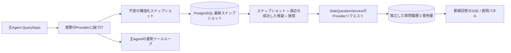

# ARTEX `/btw`

通常のチャット、タスクのMainAgent、そのタスク自身のWorkerで、主処理と独立したサイド質問を利用できます。主入力欄に`/btw 質問`と入力すると送信し、空の`/btw`または「サイド質問」ボタンで履歴を開きます。デスクトップでは幅を変更できるサイドバー、モバイルではDrawerを使用します。

回答は送信時のAgentコンテキストのスナップショットから生成され、ストリーミング表示、追加質問、停止、履歴消去に対応します。パネルを閉じる、ページを再読み込みする、SSEを切断する操作ではモデルへのリクエストは取り消されません。停止は現在のサイド質問のみに作用します。消去はサイド質問を取り消して履歴を削除しますが、主コンテキストのスナップショットは保持します。

## 実装範囲

Go、norma v0.3.7、Next.jsと既存のMarkdown / ResizablePanel / Drawer / AlertDialogを使用します。normaのソース変更や新たな依存追加はありません。Planner、別タスクから継承したWorker、ツール型サブタスクの拡張は対象外です。

- `capture.go`は`Options.Deps.CallModel / CallModelSync`でのみ主ループのリクエストを識別します。Providerデコレーターは、ルーティングプール外側の選択後、具体的モデルの内側に置くため、実際に選ばれたモデルを記録します。圧縮・要約リクエストはスナップショットを上書きしません。
- リクエスト開始、完全なモデル応答、実行の終端状態でスナップショットを公開します。生成途中の応答は公開しません。ツール呼び出しはnormaの`MessagesForAPI`で結果との対応を維持し、結果は次の主モデルリクエストまたは実行終了時に取り込みます。ストリーム中断時は直前の有効な境界を保持します。
- JSONのディープコピーで構造化メッセージ、システムプロンプト、ツール定義、生成パラメーターを保持します。モデル推論中はスナップショットのロックやDBトランザクションを保持しません。
- `SideQuestionService`は具体的なProviderを呼び出し、必要に応じて先にサイド質問用の要約を生成します。最終回答は、初回のコンテキスト超過時かつテキスト・ツール呼び出しの出力前に限り、縮小後に1回だけ再試行できます。Agentセッションは作成せず、ツール実行器、主transcript、アクティビティ、タスクグラフには接続せず、タスクのモデル切り替えチェーンも経由しません。既存の構造化ツールコンテキストとの互換性のため回答リクエストにツール定義を残しますが、要約リクエストには提供しません。新たに返されたツール呼び出しの実行経路はありません。
- 親セッションごとに同時1件、サービスプロセス全体で最大4件、1件のタイムアウトは120秒です。サービスのライフサイクル配下で独立したキャンセルコンテキストを使います。
- モデル設定への参照と機密性のない識別情報の要約を保持し、リクエスト時に既存設定から認証情報を取得します。設定の削除やモデル・プロトコル・アドレスなどの識別フィールドの変更後は、主Agentを実行してスナップショットを更新する必要があります。テストでは製品の既定モデルを変更しません。

## 永続化と復元

`db/schema.sql`が`side_question_sessions`と`side_question_requests`を自動作成します。前者は親リソース、最新スナップショット、実行番号、バージョン、消去世代を保存し、後者は質問、累積回答、状態、モデル、スナップショット時刻、使用量、イベント連番、ページング連番を保存します。

親セッションのキーはconversation ID、またはtask ID + exploration ID + intent IDです。Workerでは再利用される実行スロット名を使いません。

スナップショットは親セッションごとに書き込みをまとめ、250msごとに反映します。DBで`(run_id, version)`を比較し、古い版の上書きを防ぎます。サイド質問の受付前に選択済みスナップショットを再保存します。成功後はメモリ上の大きなスナップショットを解放し、失敗時は書き込み待ちの版を保持します。ストリームイベントで届く累積回答は最大250msに1回書き込み、終端状態は直ちに保存し、DBエラー時は回数を制限して再試行します。

起動時に残存する`running`を`interrupted`に変更し、保存済みの部分回答と使用量を残します。リクエストは自動再実行しません。直近に保存したコンテキストで次の質問を開始できます。スナップショットのない旧セッションは先に主Agentを実行する必要があり、UIのアクティビティからコンテキストを再構築しません。

消去時は消去世代を増やしてリクエストを削除し、条件付き更新で遅延コールバックの書き戻しを防ぎます。親の物理削除は外部キーのカスケードに従います。Workerの論理削除では同一トランザクションでサイド質問データも削除し、後から届くスナップショットを拒否します。タスクのアーカイブでは新規受付を止め、主処理の停止を待ち、サイド質問を取り消して保存完了を待ちます。形式はv3で、サイド質問テーブルを含まないv1/v2とも互換性があります。

履歴はすべて保存し、連番カーソルで1ページ最大20件を返します。モデルには成功した直近20組までの質疑原文を再送し、トークン予算でも量を制限します。古い質疑は独立したローリング要約にまとめます。主コンテキストが予算を超えた場合はサイド質問用コピーの古い部分だけを要約し、直近の構造化ツール呼び出しと結果を保持します。要約、準備進捗、使用量も、サイド質問の同時実行・キャンセル・120秒の制限に含みます。詳細は[コンテキスト予算と参考実装](CONTEXT_BUDGET.md)を参照してください。

## HTTP契約

次のパスを`{parent}`とし、既存の認証とリソース検証を使用します。

- `/api/conversations/{id}`
- `/api/tasks/{id}/chat`
- `/api/tasks/{id}/intents/{iid}`

| リクエスト | 応答・動作 |
| --- | --- |
| `GET {parent}/side-questions?before={ordinal}` | 新しい順の`items`、独立した`current`実行状態、`snapshot`メタ情報、`next_cursor`。カーソル0は最新ページ / 次ページなしを表す |
| `POST {parent}/side-questions` | JSON `{ "question": "…", "client_request_id": "UUID" }`。新規は202とリクエストオブジェクト、同じID・質問は既存オブジェクトと200 |
| `DELETE {parent}/side-questions` | 現在の親セッションのサイド質問を取り消し、履歴を消去 |
| `GET /api/side-questions/{requestID}/events` | `snapshot` SSEイベント。`id`は増加する連番、`data`は累積内容を含む完全なリクエストオブジェクト。消去時は`cleared` |
| `POST /api/side-questions/{requestID}/cancel` | 明示的に取り消し。終端状態は履歴またはSSEから取得可能 |

質問は最大4000文字です。スナップショットなし、モデル設定変更、同一親セッションの実行中、冪等IDの競合は409、全体の同時実行上限は429を返します。SSEは接続ごとに累積状態を先に送るため、過去に受信した断片に依存しません。フロントエンドはリクエストIDと連番でマージし、親セッション切り替え・消去時には古いコールバックを破棄します。

## 検証と参考

自動チェック、実モデルでの利用、既知の制限は[VALIDATION.md](VALIDATION.md)を参照してください。

独立リクエストは[Grok CLI side-question.ts（固定コミット）](https://github.com/superagent-ai/grok-cli/blob/fb97af83f06dca873281d60168430f06c8de6324/src/utils/side-question.ts)、実行の分離は[OpenCode（固定コミット）](https://github.com/anomalyco/opencode/tree/b3f1a96c6dd7adeb28b36dd11add1998fc84d67b)を参考にしています。ARTEXはnormaの構造化メッセージを使用し、フロントエンドログのテキスト連結は採用していません。
